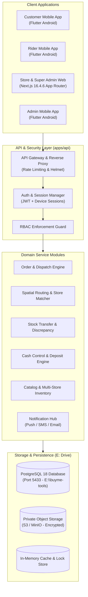
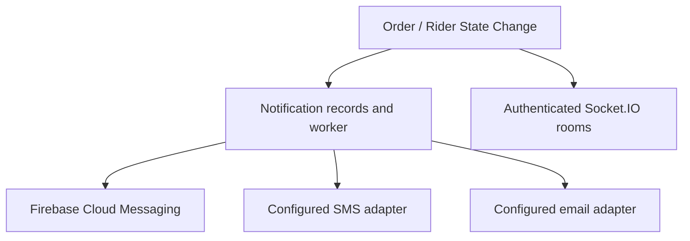

# BuyMe Supermarket Platform — System Architecture & Technical Design
**Hyperlocal Multi-Store Grocery Delivery Ecosystem (Batticaloa District, Sri Lanka)**
*Document Version: 1.0.0 • Architecture Baseline: Enterprise Modular Monolith / Microservices-Ready*

---

## 1. System Topology & Architecture Overview

The BuyMe platform coordinates physical retail operations, warehouse inventory, last-mile motorcycle fleet logistics, and customer orders across Batticaloa District. The architecture diagram is the target topology; implemented and planned areas are distinguished in the API inventory below.



---

## 2. API Module Catalog

The backend (`apps/api`) is structured into clean, modular domain boundaries:

| Module | Route Prefix | Primary Consumers | Core Capabilities / Status |
|---|---|---|---|
| **Authentication** | `/api/v1/auth` | All Clients | Implemented: phone/email OTP, JWT issue, token rotation, logout. |
| **Categories** | `/api/v1/categories` | Public, Super Admin | Implemented: public reads and audited Super Admin CRUD. |
| **Master Products** | `/api/v1/products` | Public, Super Admin | Implemented: search, multiple barcodes, audited CRUD, image upload. |
| **Warehouse Stock** | `/api/v1/warehouse/stock` | Super Admin | Implemented: stock adjustment, reorder levels, low-stock query. |
| **Stock Transfers** | `/api/v1/transfers` | Super & Store Admins | Implemented: draft, dispatch, receipt, discrepancy resolution, revert/cancel. |
| **Stores & Zones** | `/api/v1/stores` | All Clients | Implemented: nearest open store, service-radius/polygon coverage, checkout delivery-zone validation/pricing, and audited store/zone settings. Store Admins are limited to their assigned store. |
| **Store Catalog & Stock** | `/api/v1/stores/:storeId/{catalog,stock,alerts}` | Public, Store Admin, Super Admin | Implemented: public catalog reads, scoped admin stock/catalog operations, low-stock alerts. |
| **Riders & KYC** | `/api/v1/riders` | Riders, Super Admin | Implemented: phone OTP registration, private malware-scanned document submission, review, approve/assign, reject/resubmit, suspend, notifications, and audit records. |
| **Customer Hub** | `/api/v1/customers` | Customer | Planned: profile and saved-address APIs. |
| **Cart & Order Processing** | `/api/v1/cart/:storeId`, `/api/v1/orders` | Customer, Store, Rider | Implemented: per-store persistent carts, atomic COD checkout/reservations, scoped lifecycle transitions, rider assignment, COD collection, and failed-delivery restocking. |
| **Campaigns** | `/api/v1/campaigns` | Super Admin | Implemented: automatic free-delivery and code campaigns, fixed/percentage discounts, stacking, minimum subtotal, caps, order snapshots, and audit records. |
| **Cash & Deposits** | `/api/v1/cash-control` | Rider, Store & Super Admin | Implemented: threshold/time-based locks, cash ledger, signed private-slip upload/view, full-balance deposit, scoped verification queue, variance cases with Super Admin resolution, and on-demand store reconciliation. A pg-boss sweep enforces overdue locks. Live S3/MinIO remains unverified. |
| **Notification Hub** | Internal | Customer, Rider, Store Admin | Implemented queued SMS/email notifications and Firebase push using active device-session tokens; `Notification` records attempts and delivery status. Live provider delivery is not verified. |
| **Realtime** | Socket.IO `/events` namespace | Customer, Rider, Store Admin | Implemented authenticated order/store rooms, order-status events, rider-location persistence/broadcast, and per-user event limits. Rate limits are process-local. |
| **Spatial / Maps** | `/api/v1/maps` | All Clients | Implemented OSM Nominatim geocoding/reverse geocoding and OSRM routing behind `MapProvider`, with request throttling and bounded TTL cache. Live endpoints are not verified. |

---

## 3. Authentication, Token Lifecycle & RBAC Design

### 3.1 Token Lifecycle (Dual Token Rotation)
- **Short-Lived Access Token**:
  - Format: Cryptographically signed JWT (HMAC-SHA256 or RS256).
  - Lifetime: **15 minutes**.
  - Payload: `{ sub: userId, role: Role, storeId?: string, sessionId: string }`.
  - Transmission: `Authorization: Bearer <token>` header.
- **Long-Lived Rotating Refresh Token**:
  - Format: High-entropy opaque cryptorandom string (256-bit).
  - Lifetime: **30 days**.
  - Storage: Stored hashed (SHA-256) inside `device_sessions`.
  - Rotation Policy: Every use of a refresh token invalidates the previous token and issues a brand-new token pair. If a revoked or reused refresh token is presented, the entire session family for that device is immediately revoked (anti-theft detection).

### 3.2 Device Sessions & Concurrency
- Each physical login registers a unique `device_id` and registers user agent / IP.
- Customers and Riders are restricted to **2 concurrent active device sessions** to prevent credential sharing.
- Admins are alerted upon new device or new IP logins.

### 3.3 OTP Rate Limiting & Brute-Force Lockout
- **Generation**: 6-digit cryptographically secure numeric string.
- **Validity Window**: **5 minutes**.
- **Per-Code Attempt Limit**: Maximum **3 failed verification attempts** per OTP. On the 3rd failed attempt, the code is immediately invalidated.
- **Dispatch Throttling**: Maximum **3 OTP requests per 5 minutes** per destination and **10 per 5 minutes** per IP address, recorded in `rate_limit_records`.

### 3.4 Role-Based Access Control (RBAC) Matrix

| Resource / Action | `SUPER_ADMIN` (Owner) | `STORE_ADMIN` (Store Mgr) | `RIDER` (Courier) | `CUSTOMER` (Shopper) |
|---|:---:|:---:|:---:|:---:|
| **Warehouse Master Stock** | Full Control | No Access | No Access | No Access |
| **Stock Transfer Dispatch**| Full Control | No Access | No Access | No Access |
| **Stock Transfer Receive** | View / Resolve | Confirm Own Store | No Access | No Access |
| **Store Catalog & Pricing**| Global Override| Own Store Only | No Access | Read-Only (Local) |
| **Rider KYC Review** | Review, approve/assign, reject, suspend | No Access | Submit own KYC | No Access |
| **Rider Shift & GPS** | Fleet View | Own Store Fleet | Self (Update Shift) | Tracking Own Order |
| **Assign Store Rider** | Override | Own Store Only | No Access | No Access |
| **Rider Cash Meter** | Global View | Own Store View | Self View | No Access |
| **Deposit Verification** | Approve / Reject| Approve Own Store| Submit Slip | No Access |
| **Browse & Add to Cart** | Internal | Internal | No Access | Allowed (Store-Scoped) |
| **Place COD Order** | No | No | No | Allowed |
| **Order Status Update** | Full Control | Step 1-2 (Prep/Ready)| Step 3 (Delivery) | Cancel before Accept |

---

## 4. File Storage & Upload Architecture

### Product Catalog Images (implemented)

Super Admins upload product images through `POST /api/v1/products/:id/image`. The API accepts PNG, JPEG, or WebP up to 5 MB, assigns a UUID filename, stores files under `STORAGE_LOCAL_DIR/products`, and serves them at `/uploads/products/:filename`. On the current Windows setup, the configured storage directory is on E:. These public catalog images are not suitable for KYC documents, bank slips, or other private data.

### Private Storage for Rider Bank Receipts (implemented; S3-compatible provider configuration required)

Bank deposit slips contain financial records and are stored in a private S3-compatible bucket. The API supports AWS S3 and MinIO-compatible endpoints through `OBJECT_STORAGE_*` environment variables; credentials are not committed to the repository.

```mermaid
sequenceDiagram
    autonumber
    actor Rider as Rider / App Client
    participant API as BuyMe API
    participant Storage as Private S3 / MinIO
    actor Admin as Store / Super Admin

    Rider->>API: POST /api/v1/cash-control/deposits/upload-url
    Note over API: Authenticates rider; signs content type and 1-5 MB content length
    API-->>Rider: Return { uploadUrl, objectKey, requiredHeaders }
    Rider->>Storage: Direct PUT to signed URL
    Rider->>API: POST /api/v1/cash-control/deposits { amount, bankRefNumber, objectKey }
    API->>Storage: HEAD metadata and read file signature
    API-->>Rider: Return pending deposit without exposing object key
    Admin->>API: GET /api/v1/cash-control/deposits/:id/slip-url
    Note over API: Authorizes assigned store admin or super admin
    API->>Storage: Generate signed GET URL (up to 10 minutes)
    API-->>Admin: Return temporary private URL
```

### Key Security Controls:
1. **Zero Public Buckets**: Storage buckets have public access completely disabled (`BlockPublicAcls`, `BlockPublicPolicy`).
2. **Pre-Signed Uploads (PUT)**: Client uploads directly to private storage; content type and content length are signed.
3. **Strict Validation**: Only JPEG, PNG, or PDF slips up to **5 MB** are accepted, and uploaded bytes are checked against the declared type before submission.
4. **Short-Lived Ephemeral Viewing (GET)**: Authorized rider/store/super-admin users receive private GET URLs expiring within **10 minutes**.
5. **Verification Controls**: Only full-balance deposits are accepted; a rider is locked while verification is pending, approval resets the cash meter, and rejection leaves the rider locked.

The e2e suite exercises the S3-compatible signing and upload flow against a local test server. No live AWS S3 or MinIO endpoint has been configured or verified.

### Private Storage for Rider KYC (implemented; S3 and ClamAV configuration required)

The rider onboarding workflow uses separate private upload and document object prefixes. A rider can only request upload URLs under their own rider ID. The API validates the upload metadata and image signature, downloads the complete image for a fail-closed ClamAV `INSTREAM` scan, then copies clean files to a non-uploadable private document key before storing those keys. Signed PUT URLs can remain live briefly, but overwriting their temporary object cannot modify the reviewed document. Only Super Admins can request short-lived document view URLs.

```mermaid
sequenceDiagram
    autonumber
    actor Rider
    participant API as BuyMe API
    participant DB as PostgreSQL
    participant Store as Private S3 / MinIO
    participant AV as ClamAV
    actor Admin as Super Admin

    Rider->>API: POST /api/v1/auth/rider/registration/otp-request
    Rider->>API: POST /api/v1/auth/rider/registration/otp-verify
    API->>DB: Create RIDER + REGISTERED profile; save audit and notification outbox
    Rider->>API: POST /api/v1/riders/me/kyc/upload-url (for each image)
    API-->>Rider: Signed PUT URLs for JPEG/PNG/WebP (max 5 MB each)
    Rider->>Store: PUT temporary uploads
    Rider->>API: POST /api/v1/riders/me/kyc/submit
    API->>Store: Verify metadata/signature and read bytes
    API->>AV: Scan each complete image (fail closed)
    API->>Store: Copy clean images to immutable review-document keys
    API->>DB: Save KYC_SUBMITTED, audit, and SMS/email/push notification records
    Admin->>API: GET /api/v1/riders/review-queue
    Admin->>API: GET /api/v1/riders/{riderId}/kyc/{documentType}/url
    API->>Store: Generate short-lived private GET URL
    Admin->>API: POST /api/v1/riders/{riderId}/approve or /reject
    API->>DB: Assign store/type or persist rejection; save audit and notifications
```

KYC upload security requires a private bucket with PUT/GET/HEAD/COPY/DELETE permissions for the API, narrowly scoped client CORS for signed PUT requests, and a lifecycle rule to expire temporary `rider-kyc/*/uploads/` objects. `CLAMAV_HOST` and `CLAMAV_PORT` configure the scanner; a missing or unavailable scanner blocks submission. Notification delivery uses `SMS_PROVIDER=twilio`, `EMAIL_PROVIDER=resend`, and optional OneSignal credentials. The mobile app must identify the authenticated BuyMe user UUID as the OneSignal external ID. Notification attempts and failures are persisted; live providers have not been configured or verified.

---

## 5. Map & Routing Provider Abstraction (`MapProvider`)

Map operations are behind a provider interface. The API exposes public validated routes for geocoding, reverse geocoding, and driving directions:

```typescript
export interface MapLocation {
  latitude: number;
  longitude: number;
  displayName: string;
}

export interface MapRoute {
  distanceMeters: number;
  durationSeconds: number;
  coordinates: Array<[number, number]>;
}

export interface MapPoint {
  latitude: number;
  longitude: number;
}

export interface MapProvider {
  geocode(query: string): Promise<MapLocation>;
  reverseGeocode(latitude: number, longitude: number): Promise<MapLocation>;
  route(from: MapPoint, to: MapPoint): Promise<MapRoute>;
}
```

- **Default implementation**: OpenStreetMap Nominatim for geocoding/reverse geocoding and OSRM for driving routes.
- **Public routes**: `GET /api/v1/maps/geocode?q=...`, `GET /api/v1/maps/reverse-geocode?latitude=...&longitude=...`, and `GET /api/v1/maps/route` with validated endpoint coordinates.
- **Reliability controls**: Nominatim requests are throttled; successful provider results use a bounded in-memory TTL cache. Provider HTTP or malformed-response errors are surfaced; there is no silent straight-line routing fallback.
- **Store selection**: `POST /api/v1/stores/find-nearest` chooses among open stores that cover the point by service radius/polygon. Points outside every service area or with no open eligible store are rejected; equal-distance matches use store code as a stable tie-breaker.

---

## 6. Multi-Channel Notification Hub Architecture

Notification intents are persisted with processing state and attempt counts. The worker dispatches through the configured Firebase push, SMS, and email adapters; live provider delivery requires credentials and is not verified here.



Order state changes are published to authorized order/store rooms; rider location is persisted before broadcast to the customer's order room and assigned store. Socket authentication checks the JWT against the current active user record, and room joins enforce customer, assigned-rider, or store-admin ownership. Per-user event limits are enforced in-process and are not shared across multiple API instances.

The configurable store-accept deadline defaults to five minutes. pg-boss schedules an order deadline and a periodic overdue-order sweep. If an order remains `PLACED` past its deadline, the worker rejects it, cancels COD, releases the stock reservation, and records a store alert, timeline entry, audit event, and queued notifications. This is automatic order escalation/rejection, not a claim that a Super Admin has acknowledged the alert.

---

## 7. Risks, Edge Cases & Mitigation Strategies

| Risk / Edge Case | Impact | Mitigation Strategy |
|---|---|---|
| **Intermittent Mobile Connectivity** in rural Batticaloa outskirts (e.g. lagoon areas, Vellavely). | Telemetry dropouts, rider unable to mark delivery. | Local client queue in Flutter apps; actions timestamped locally and synchronised automatically upon reconnect; SMS fallback for vital status codes. |
| **Rider Cash Accumulation Risk** (rider absconds with COD collections). | Financial loss for the store/platform. | Strict enforcement of the **LKR 10,000 threshold** and **4-hour holding window**. Once locked, the rider cannot accept any further orders until a bank deposit slip is verified. |
| **Stock Discrepancy during Transit** (damaged goods or missing boxes between Main Warehouse and Store). | Inventory mismatch, unaccounted loss. | Mandatory two-party confirmation: Store Admin confirms item-by-item received counts. Any deficit automatically creates an immutable `DISCREPANCY` record and alerts Super Admin for resolution before store stock increases. |
| **Cross-Store Cart Poisoning** (customer selects items from Batticaloa Town, then switches delivery address to Eravur). | Unfulfillable delivery, stock locked across depots. | Cart is strictly pinned to one store hub. Changing the delivery address triggers spatial store re-matching. If the store changes, the client displays an explicit modal: *"Your basket will be cleared to switch to the Eravur store hub."* |
| **High Concurrency Stock Overselling** (multiple customers buying the last packet of Keeri Samba rice simultaneously). | Customer dissatisfaction, unfulfilled orders. | Database row-level locking (`SELECT ... FOR UPDATE` in PostgreSQL transactions) during the checkout step to decrement available stock and increment reserved stock atomically. |
