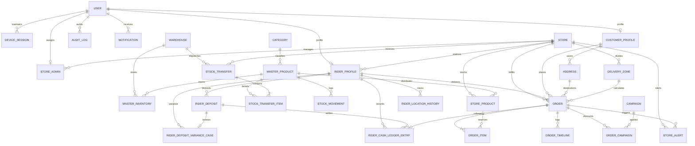
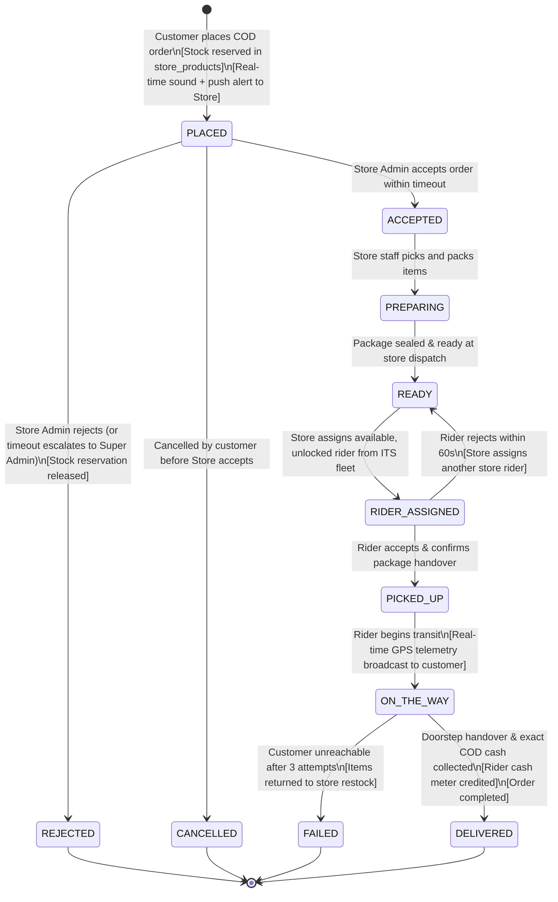
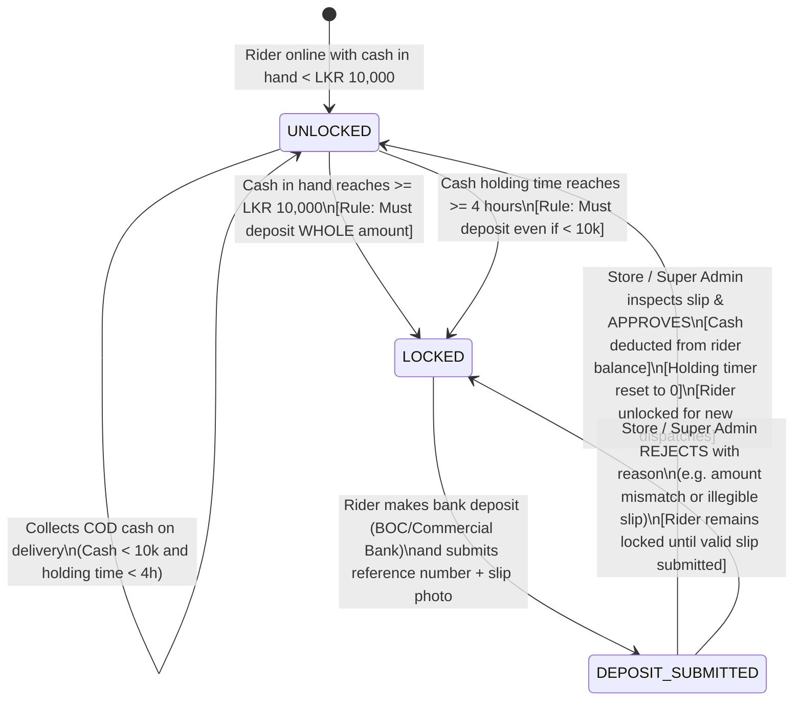

# BuyMe Supermarket Platform — Comprehensive Data Model
**Hyperlocal Multi-Store Grocery Delivery Platform (Batticaloa District, Sri Lanka)**
*Document Version: 1.0.0 • Database Target: PostgreSQL 18*

---

## 1. Entity-Relationship Overview

The BuyMe platform operates a multi-facility supply chain model:
1. **One Main Central Warehouse**: Run by the `SUPER_ADMIN` (platform owner). Holds the master catalog, receives supplier shipments via barcode scan / name / manual entry, and dispatches stock transfers.
2. **10 Hyperlocal Store Hubs**: Stationed across Batticaloa District (`BM-S01` to `BM-S10`), run by `STORE_ADMIN`s. Each store maintains its own isolated catalog, stock levels, custom prices (if permitted), opening hours, geospatial service area polygon, and delivery zones.
3. **Delivery Rider Fleet**: Assigned to exactly one store upon Super Admin KYC approval. Subject to strict Cash on Delivery (COD) limits (LKR 10,000 limit, 4-hour window, deposit slips).
4. **Customers**: Phone-based OTP authentication with saved geospatial delivery coordinates.



---

## 2. Table Dictionary & Schema Specifications

### 2.1 Identity & Session Models

#### `users`
Core user identity for all system personas.
| Column | Type | Constraints | Description |
|---|---|---|---|
| `id` | UUID | Primary Key | Unique user identifier |
| `phone` | VARCHAR(20) | UNIQUE, Nullable | E.164 phone number (`+9477...`) |
| `email` | VARCHAR(255) | UNIQUE, Nullable | Contact and notification email |
| `password_hash` | VARCHAR(255) | Nullable | Argon2id/Bcrypt hash (admins) |
| `role` | ENUM | NOT NULL | `SUPER_ADMIN`, `STORE_ADMIN`, `RIDER`, `CUSTOMER` |
| `full_name` | VARCHAR(150) | NOT NULL | User's legal name |
| `is_active` | BOOLEAN | DEFAULT true | Account status flag |
| `created_at` | TIMESTAMP | DEFAULT now() | Registration timestamp |
| `updated_at` | TIMESTAMP | AUTO UPDATE | Last update timestamp |

**Indexes:**
- `@@index([role, is_active])`
- `@@index([phone])`
- `@@index([email])`

#### `device_sessions`
Active client tokens and device sessions (Access + Rotating Refresh).
| Column | Type | Constraints | Description |
|---|---|---|---|
| `id` | UUID | Primary Key | Session UUID |
| `user_id` | UUID | FK -> `users(id)` | Parent user account |
| `refresh_token_hash` | VARCHAR(255) | UNIQUE, NOT NULL | SHA-256 hash of rotating refresh token |
| `device_id` | VARCHAR(100) | NOT NULL | Client installation / hardware UUID |
| `device_info` | VARCHAR(255) | Nullable | OS, Model (e.g. `Pixel 7 - Android 14`) |
| `ip_address` | VARCHAR(45) | Nullable | Client IP address |
| `user_agent` | TEXT | Nullable | Client HTTP User-Agent string |
| `is_revoked` | BOOLEAN | DEFAULT false | Revocation flag |
| `expires_at` | TIMESTAMP | NOT NULL | Refresh token absolute expiration |
| `created_at` | TIMESTAMP | DEFAULT now() | Session creation timestamp |
| `last_used_at` | TIMESTAMP | DEFAULT now() | Last activity timestamp |

**Indexes:**
- `@@index([user_id, is_revoked])`
- `@@index([refresh_token_hash])`

#### `otp_requests`
Verification codes for passwordless customer and rider logins.
| Column | Type | Constraints | Description |
|---|---|---|---|
| `id` | UUID | Primary Key | Request UUID |
| `destination` | VARCHAR(100) | NOT NULL | Phone number or email address |
| `purpose` | ENUM | NOT NULL | `LOGIN`, `REGISTRATION`, `PASSWORD_RESET` |
| `code_hash` | VARCHAR(255) | NOT NULL | Salted HMAC/SHA-256 hash of 6-digit OTP |
| `attempts_count` | INT | DEFAULT 0 | Failed verification count (max 3) |
| `is_used` | BOOLEAN | DEFAULT false | Invalidation flag upon consumption |
| `expires_at` | TIMESTAMP | NOT NULL | OTP validity cutoff (5 minutes) |
| `created_at` | TIMESTAMP | DEFAULT now() | Dispatch timestamp |

**Indexes:**
- `@@index([destination, purpose, is_used])`
- `@@index([expires_at])`

---

### 2.2 Facility & Geospatial Infrastructure

#### `warehouses`
Central fulfillment hub (Super Admin operated).
| Column | Type | Constraints | Description |
|---|---|---|---|
| `id` | UUID | Primary Key | Warehouse UUID |
| `code` | VARCHAR(20) | UNIQUE, NOT NULL | Human-readable code (`WH-MAIN`) |
| `name` | VARCHAR(150) | NOT NULL | Facility display name |
| `address` | TEXT | NOT NULL | Physical street address in Batticaloa |
| `latitude` | DECIMAL(10, 7) | NOT NULL | Geolocation coordinate |
| `longitude` | DECIMAL(10, 7) | NOT NULL | Geolocation coordinate |
| `contact_phone` | VARCHAR(20) | NOT NULL | Dispatch desk phone number |
| `is_active` | BOOLEAN | DEFAULT true | Operational state |

**Geospatial Indexes:**
- `@@index([latitude, longitude])`

#### `stores`
10 regional Batticaloa store hubs (`BM-S01` to `BM-S10`).
| Column | Type | Constraints | Description |
|---|---|---|---|
| `id` | UUID | Primary Key | Store UUID |
| `code` | VARCHAR(20) | UNIQUE, NOT NULL | Fixed store code (`BM-S01`..`BM-S10`) |
| `name` | VARCHAR(150) | NOT NULL | Store display name |
| `slug` | VARCHAR(100) | UNIQUE, NOT NULL | URL slug (e.g. `batticaloa-town`) |
| `address` | TEXT | NOT NULL | Street address |
| `locality` | VARCHAR(100) | NOT NULL | Town (Puliyanthivu, Kattankudy, etc.) |
| `latitude` | DECIMAL(10, 7) | NOT NULL | Latitude point |
| `longitude` | DECIMAL(10, 7) | NOT NULL | Longitude point |
| `contact_phone` | VARCHAR(20) | NOT NULL | Store manager hotline |
| `contact_email` | VARCHAR(255) | Nullable | Store contact email |
| `is_active` | BOOLEAN | DEFAULT true | Store active flag |
| `opening_time` | VARCHAR(5) | DEFAULT "07:00" | Daily open time (HH:mm) |
| `closing_time` | VARCHAR(5) | DEFAULT "22:00" | Daily close time (HH:mm) |
| `service_radius_km`| DECIMAL(5, 2)| DEFAULT 10.00 | Fallback radial coverage |
| `service_area_polygon`| JSON | Nullable | GeoJSON coordinates of boundary |
| `allow_price_override`| BOOLEAN | DEFAULT false | Permit store-specific price adjustments |
| `min_order_amount` | DECIMAL(10, 2) | DEFAULT 500.00 | Minimum cart requirement (LKR) |
| `free_delivery_threshold`| DECIMAL(10, 2)| DEFAULT 5000.00| Order value unlocking free delivery |
| `cash_hold_threshold` | DECIMAL(10, 2) | DEFAULT 10000.00| Max cash rider can hold (LKR) |
| `cash_hold_max_hours` | INT | DEFAULT 4 | Max hours rider can hold cash |

**Geospatial & Filtering Indexes:**
- `@@index([latitude, longitude])` (Spatial proximity matching)
- `@@index([is_active])`

#### `delivery_zones`
Zonal pricing tiers per store (Zones 1 to 5).
| Column | Type | Constraints | Description |
|---|---|---|---|
| `id` | UUID | Primary Key | Zone UUID |
| `store_id` | UUID | FK -> `stores(id)` | Parent store hub |
| `zone_number` | INT | NOT NULL | Zone index (1..5) |
| `name` | VARCHAR(100) | NOT NULL | Zone label (e.g. `Zone 1: Central Puliyanthivu`) |
| `polygon_coordinates` | JSON | Nullable | Precise polygon GeoJSON geometry |
| `radius_km` | DECIMAL(5, 2) | Nullable | Radial distance fallback boundary |
| `base_fee` | DECIMAL(10, 2) | NOT NULL | Delivery fee in LKR (200 - 550) |
| `min_order_for_free_delivery`| DECIMAL(10, 2)| DEFAULT 5000.00 | Free delivery minimum |
| `estimated_delivery_mins` | INT | DEFAULT 30 | Delivery ETA estimate |
| `is_active` | BOOLEAN | DEFAULT true | Active pricing tier |

**Indexes:**
- `@@unique([store_id, zone_number])`
- `@@index([store_id, is_active])`

---

### 2.3 Master Catalog & Inventory Control

#### `master_products`
Central product definitions managed by Super Admin.
| Column | Type | Constraints | Description |
|---|---|---|---|
| `id` | UUID | Primary Key | Product UUID |
| `barcode` | VARCHAR(100) | UNIQUE, NOT NULL | EAN-13 / Code-128 barcode |
| `sku` | VARCHAR(50) | UNIQUE, NOT NULL | Stock Keeping Unit |
| `name` | VARCHAR(200) | NOT NULL | English product name |
| `name_ta` | VARCHAR(200) | Nullable | Tamil product name (தமிழ்) |
| `category_id` | UUID | FK -> `categories(id)` | Product category |
| `unit` | VARCHAR(20) | NOT NULL | Unit of measure (`kg`, `pack`, `l`, etc.) |
| `cost_price` | DECIMAL(10, 2) | NOT NULL | Super Admin acquisition cost (LKR) |
| `base_selling_price`| DECIMAL(10, 2)| NOT NULL | Standard retail price (LKR) |
| `image_url` | VARCHAR(500) | Nullable | CDN / local asset illustration URL |
| `is_active` | BOOLEAN | DEFAULT true | Active catalog flag |

**Indexes:**
- `@@index([barcode])` (High-speed barcode scanner lookups)
- `@@index([name])`
- `@@index([category_id, is_active])`

#### `master_product_barcodes`
Additional scannable codes for a master product. The legacy `master_products.barcode` remains its primary barcode; additional codes are globally unique and cascade with their product.
| Column | Type | Constraints | Description |
|---|---|---|---|
| `id` | UUID | Primary Key | Barcode row UUID |
| `master_product_id` | UUID | FK -> `master_products(id)` | Owning product |
| `barcode` | VARCHAR(100) | UNIQUE, NOT NULL | Additional product barcode |
| `created_at` | TIMESTAMP | DEFAULT now() | Row creation time |

#### `master_inventories`
Stock on hand at the Main Warehouse.
| Column | Type | Constraints | Description |
|---|---|---|---|
| `id` | UUID | Primary Key | Inventory record UUID |
| `warehouse_id` | UUID | FK -> `warehouses(id)`| Main warehouse reference |
| `master_product_id`| UUID | FK -> `master_products(id)`| Master product reference |
| `quantity_on_hand` | INT | DEFAULT 0 | Physical stock available |
| `quantity_reserved`| INT | DEFAULT 0 | Stock reserved for downstream allocation |
| `reorder_level` | INT | DEFAULT 50 | Low-stock alert threshold |

**Indexes:**
- `@@unique([warehouse_id, master_product_id])`
- `@@index([warehouse_id])`
- `@@index([master_product_id])`

#### `store_products`
Store-specific catalog, pricing overrides, and local stock.
| Column | Type | Constraints | Description |
|---|---|---|---|
| `id` | UUID | Primary Key | Store stock record UUID |
| `store_id` | UUID | FK -> `stores(id)` | Assigned store hub |
| `master_product_id`| UUID | FK -> `master_products(id)`| Master product definition |
| `custom_price` | DECIMAL(10, 2) | Nullable | Store price override (if allowed) |
| `is_available` | BOOLEAN | DEFAULT true | Store availability toggle |
| `quantity_on_hand` | INT | DEFAULT 0 | Local store physical stock |
| `quantity_reserved`| INT | DEFAULT 0 | Reserved for customer orders in progress |
| `reorder_level` | INT | DEFAULT 10 | Store replenishment threshold |

**Indexes:**
- `@@unique([store_id, master_product_id])`
- `@@index([store_id, is_available])`
- `@@index([master_product_id])`

Warehouse and store stock rows enforce non-negative on-hand/reserved quantities and `quantity_reserved <= quantity_on_hand`. Stock changes use database transactions, advisory locks for row creation, and `SELECT ... FOR UPDATE` before updating an existing stock row.

#### `stock_movements`
Immutable double-entry ledger tracking every physical quantity change.
| Column | Type | Constraints | Description |
|---|---|---|---|
| `id` | UUID | Primary Key | Ledger transaction UUID |
| `movement_type` | ENUM | NOT NULL | Type of stock transaction |
| `reference_id` | VARCHAR(100) | Nullable | Transfer ID, Order ID, Adjustment ID |
| `from_location_type`| ENUM | NOT NULL | `WAREHOUSE`, `STORE`, `IN_TRANSIT`, etc. |
| `from_location_id` | VARCHAR(100) | Nullable | Source facility UUID |
| `to_location_type` | ENUM | NOT NULL | Destination location type |
| `to_location_id` | VARCHAR(100) | Nullable | Destination facility UUID |
| `master_product_id`| UUID | FK -> `master_products(id)`| Item moved |
| `quantity` | INT | NOT NULL | Quantity transferred/adjusted |
| `unit_cost` | DECIMAL(10, 2) | NOT NULL | Unit cost at time of movement |
| `unit_price` | DECIMAL(10, 2) | Nullable | Selling price if applicable |
| `reason` | TEXT | Nullable | Audit note or discrepancy explanation |
| `created_by_user_id`| UUID | Nullable FK -> `users(id)`| User who authorized movement, when available |
| `created_at` | TIMESTAMP | DEFAULT now() | Immutable timestamp |

**Indexes:**
- `@@index([movement_type, reference_id])`
- `@@index([master_product_id, created_at])`
- `@@index([from_location_type, from_location_id])`
- `@@index([to_location_type, to_location_id])`

The database rejects non-positive movement quantities and blocks all stock-movement updates and deletes with an immutable-ledger trigger.

#### `store_alerts`
Store-scoped operational alerts. Low-stock alerts are associated with a product and include the observed quantity and reorder level in `details`; an open alert is acknowledged when stock recovers or it is explicitly acknowledged by a store administrator.
| Column | Type | Constraints | Description |
|---|---|---|---|
| `id` | UUID | Primary Key | Alert UUID |
| `store_id` | UUID | FK -> `stores(id)` | Store receiving the alert |
| `master_product_id` | UUID | Nullable FK -> `master_products(id)` | Product associated with stock alerts |
| `alert_type` | VARCHAR(50) | NOT NULL | Alert classification (for example `LOW_STOCK`) |
| `details` | JSONB | Nullable | Alert-specific structured values |
| `is_acknowledged` | BOOLEAN | DEFAULT false | Open/acknowledged state |
| `acknowledged_at` | TIMESTAMP | Nullable | Acknowledgement time |
| `created_at` | TIMESTAMP | DEFAULT now() | Alert creation time |

---

### 2.4 Stock Transfer & Discrepancy Tracking

#### `stock_transfers`
Inter-facility transfers from Main Warehouse to Stores.
| Column | Type | Constraints | Description |
|---|---|---|---|
| `id` | UUID | Primary Key | Transfer UUID |
| `transfer_number` | VARCHAR(50) | UNIQUE, NOT NULL | E.g. `TRF-2026-1001` |
| `from_warehouse_id`| UUID | FK -> `warehouses(id)`| Main Warehouse origin |
| `to_store_id` | UUID | FK -> `stores(id)` | Receiving Store Hub |
| `status` | ENUM | DEFAULT `DRAFT` | `DRAFT`, `DISPATCHED`, `RECEIVED_FULL`, `RECEIVED_PARTIAL`, `RESOLVED`, `CANCELLED` |
| `dispatched_by_user_id`| UUID | FK -> `users(id)`| Super Admin dispatcher |
| `dispatched_at` | TIMESTAMP | Nullable | Dispatch time |
| `received_by_user_id` | UUID | FK -> `users(id)`| Store Admin receiver |
| `received_at` | TIMESTAMP | Nullable | Confirmation time |
| `resolved_by_user_id` | UUID | FK -> `users(id)`| Super Admin resolver |
| `resolved_at` | TIMESTAMP | Nullable | Resolution time |
| `resolution_note` | TEXT | Nullable | Super Admin resolution explanation |

**Indexes:**
- `@@index([from_warehouse_id, status])`
- `@@index([to_store_id, status])`
- `@@index([transfer_number])`

#### `stock_transfer_items`
Itemized quantities dispatched and confirmed received per transfer.
| Column | Type | Constraints | Description |
|---|---|---|---|
| `id` | UUID | Primary Key | Item line UUID |
| `transfer_id` | UUID | FK -> `stock_transfers(id)`| Parent transfer |
| `master_product_id` | UUID | FK -> `master_products(id)`| Product transferred |
| `requested_quantity` | INT | NOT NULL | Initial order quantity |
| `dispatched_quantity`| INT | DEFAULT 0 | Quantity leaving warehouse |
| `received_quantity` | INT | Nullable | Quantity verified by store |
| `discrepancy_quantity`| INT | DEFAULT 0 | `dispatched - received` |
| `item_status` | ENUM | DEFAULT `PENDING` | `PENDING`, `MATCHED`, `DISCREPANT`, `RESOLVED_WRITE_OFF`, `RESOLVED_REVERTED` |
| `notes` | TEXT | Nullable | Store receiving notes / breakages |

**Indexes:**
- `@@unique([transfer_id, master_product_id])`
- `@@index([transfer_id, item_status])`

Database checks enforce positive requested quantities, dispatched quantities within the requested amount, received quantities within the dispatched amount, and discrepancy quantities equal to dispatched minus received once a receipt is recorded. Transfers are locked while changing state so duplicate dispatch/receipt operations cannot apply stock changes twice.

---

### 2.5 Rider KYC, Telemetry & Cash Control

#### `rider_profiles`
Delivery fleet specifications, KYC verification, shift status, and COD cash meter.
| Column | Type | Constraints | Description |
|---|---|---|---|
| `id` | UUID | Primary Key | Rider record UUID |
| `user_id` | UUID | UNIQUE, FK -> `users(id)`| User account |
| `rider_type` | ENUM | DEFAULT `EMPLOYEE` | `EMPLOYEE` or `FREELANCE` |
| `kyc_status` | ENUM | DEFAULT `REGISTERED` | `REGISTERED`, `KYC_SUBMITTED`, `APPROVED`, `REJECTED`, `SUSPENDED` |
| `assigned_store_id` | UUID | FK -> `stores(id)` | Exactly one store hub upon approval |
| `bike_number` | VARCHAR(50) | Nullable | Registration (e.g. `EP BDF-4821`) |
| `bike_model` | VARCHAR(100) | Nullable | Model (e.g. `Bajaj Discover 125cc`) |
| `driving_licence_number`| VARCHAR(50)| Nullable | National driving licence number |
| `driving_licence_photo_url`| VARCHAR(500)| Nullable | Legacy field; not used by current KYC upload flow |
| `revenue_licence_photo_url`| VARCHAR(500)| Nullable | Legacy field; not used by current KYC upload flow |
| `driving_licence_object_key` | VARCHAR(500) | UNIQUE, Nullable | Private scanned document object key |
| `vehicle_licence_object_key` | VARCHAR(500) | UNIQUE, Nullable | Private scanned bike/vehicle licence object key |
| `rejection_reason` | TEXT | Nullable | Explanation if Super Admin rejects |
| `approved_by_user_id` | UUID | FK -> `users(id)` | Super Admin who approved KYC |
| `approved_at` | TIMESTAMP | Nullable | Verification timestamp |
| `is_shift_active` | BOOLEAN | DEFAULT false | Online shift status |
| `current_location_lat` | DECIMAL(10, 7)| Nullable | Real-time GPS coordinate |
| `current_location_lng` | DECIMAL(10, 7)| Nullable | Real-time GPS coordinate |
| `last_location_update` | TIMESTAMP | Nullable | GPS ping timestamp |
| `cash_in_hand` | DECIMAL(10, 2)| DEFAULT 0.00 | Accumulated COD cash (LKR) |
| `oldest_cash_collection_time`| TIMESTAMP | Nullable | Timestamp of oldest un-deposited cash |
| `is_cash_locked` | BOOLEAN | DEFAULT false | True when the assigned store's cash threshold or hold-time limit is reached |
| `cash_lock_reason` | TEXT | Nullable | Reason for dispatch lock |
| `deposit_pending` | BOOLEAN | DEFAULT false | True while deposit awaiting approval |
| `rating` | DECIMAL(3, 2) | DEFAULT 5.00 | Performance rating (1.00 - 5.00) |
| `total_completed_deliveries`| INT | DEFAULT 0 | Completed orders count |

#### Rider registration and KYC implementation
- Public registration OTP is sent to the Sri Lankan phone number, hashed in `otp_requests` with purpose `REGISTRATION`, and limited by the existing per-destination and per-IP OTP quotas. Verification creates a `RIDER` user and a `REGISTERED` profile.
- Riders upload JPEG, PNG, or WebP images no larger than 5 MB through rider-scoped signed PUT URLs. The API checks S3 metadata and file signatures, scans full bytes through ClamAV `INSTREAM` (fail closed), and copies clean files to a separate private documents prefix before persisting object keys.
- Super Admin review queue only lists `KYC_SUBMITTED` riders. Approval requires an active store and a rider type; rejection requires a reason. Rejected riders may upload new images and resubmit. Suspension deactivates the user, stops their shift, and revokes existing sessions.
- Every registration/KYC state transition writes an audit entry and queues SMS, email, and push notification records. Delivery results are stored as `SENT` or `FAILED`; configure Twilio, Resend, and OneSignal credentials to enable live delivery. Rider mobile clients must set their OneSignal external user ID to the BuyMe user UUID.
- Only `APPROVED` riders with an active account and assigned store can read cash operations or transition assigned orders. Object storage must be private, expose narrowly scoped PUT CORS, and expire temporary `rider-kyc/*/uploads/` files using a lifecycle rule.

**Indexes:**
- `@@index([assigned_store_id, is_shift_active, is_cash_locked])` (Store order dispatch query)
- `@@index([kyc_status])`
- `@@index([current_location_lat, current_location_lng])` (Spatial rider proximity)

#### `rider_deposits`
Bank deposit slip submissions to reconcile collected COD cash.
| Column | Type | Constraints | Description |
|---|---|---|---|
| `id` | UUID | Primary Key | Deposit UUID |
| `deposit_number` | VARCHAR(50) | UNIQUE, NOT NULL | E.g. `DEP-2026-5501` |
| `rider_id` | UUID | FK -> `rider_profiles(id)`| Depositing rider |
| `store_id` | UUID | FK -> `stores(id)` | Store hub where cash is credited |
| `amount` | DECIMAL(10, 2)| NOT NULL | Deposit amount in LKR |
| `bank_ref_number` | VARCHAR(100)| NOT NULL | Bank receipt / transaction ID |
| `slip_image_url` | VARCHAR(500)| NOT NULL | Private signed URL to bank slip |
| `status` | ENUM | DEFAULT `PENDING` | `PENDING`, `APPROVED`, `VARIANCE`, `APPROVED_WITH_VARIANCE`, `REJECTED` |
| `submitted_at` | TIMESTAMP | DEFAULT now() | Submission timestamp |
| `verified_by_user_id`| UUID | FK -> `users(id)` | Admin who verified deposit |
| `verified_at` | TIMESTAMP | Nullable | Verification timestamp |
| `rejection_reason` | TEXT | Nullable | Rejection feedback |
| `received_amount` | DECIMAL(10, 2) | Nullable | Bank-confirmed amount when a variance is reported |
| `variance_amount` | DECIMAL(10, 2) | Nullable | Received amount minus expected deposit |
| `variance_reason` | TEXT | Nullable | Explanation for a reported mismatch |

**Indexes:**
- `@@index([rider_id, status])`
- `@@index([store_id, status])`
- `@@index([deposit_number])`

#### Cash ledger, variance review, and reconciliation
- Riders can request short-lived S3-compatible signed upload URLs for JPEG, PNG, or PDF receipts up to 5 MB. Deposit submission checks the object key belongs to that rider, verifies S3 metadata and file signature, and never returns the private object key to clients.
- A deposit must equal the rider's entire current cash balance. Only one deposit may be pending per rider, and active deliveries must be completed first. Bank references are normalized and serialized per store to prevent duplicate submissions.
- COD collection, migrated opening balances, deposit settlements, and variance adjustments are recorded in `rider_cash_ledger_entries` with signed amounts and resulting balances. The application only appends entries.
- Submission is allowed only after the store's configured cash threshold or hold-time limit is reached, and locks the rider until verification. Approval requires the balance still to match, then records a settlement and resets cash, hold time, and lock fields atomically. Rejection requires a reason, preserves the balance, and leaves the rider locked.
- A store verifier can open a variance case by recording the bank-received amount and reason. The rider remains locked while the case is open. Only a Super Admin can accept the bank amount and post a variance adjustment, or reject the deposit while keeping the cash balance locked.
- Store admins can list and verify deposits only for their assigned store; riders can access only their own records; super admins can access all stores. Authorized users receive a signed slip-download URL with a maximum ten-minute lifetime.
- `cashHoldThreshold` and `cashHoldMaxHours` are configurable per store. A pg-boss scheduled sweep persists overdue locks; checks on cash access, deposit upload/submission, order assignment, and COD collection enforce the same rule.
- Store/Super Admins can request an on-demand daily reconciliation by store business date (`Asia/Colombo`). The report sums opening cash, COD collections, approved bank deposits, variance adjustments, and closing cash from ledger entries.
- The API supports S3-compatible endpoints, but live AWS S3/MinIO connectivity is not yet configured or verified.

The Gate 6 migration adds the cash ledger and variance-case tables, deposit variance fields/statuses, campaign tables, order campaign snapshots, indexes, foreign keys, and opening-balance ledger entries for riders with existing cash balances. It is pending approval for the populated database and Supabase.

#### `rider_cash_ledger_entries`
Append-only cash activity used for rider balances and daily reconciliation.
| Column | Type | Constraints | Description |
|---|---|---|---|
| `id` | UUID | Primary Key | Ledger entry UUID |
| `rider_id` | UUID | FK -> `rider_profiles(id)` | Cash-account owner |
| `store_id` | UUID | FK -> `stores(id)` | Store responsible for the cash |
| `entry_type` | ENUM | NOT NULL | `OPENING_BALANCE`, `DELIVERY_COLLECTION`, `DEPOSIT_SETTLEMENT`, `VARIANCE_ADJUSTMENT` |
| `amount` | DECIMAL(10, 2) | NOT NULL | Signed change to the cash balance |
| `balance_after` | DECIMAL(10, 2) | NOT NULL | Balance after this entry |
| `order_id` | UUID | UNIQUE, Nullable | COD order; one collection entry per order |
| `deposit_id` | UUID | Nullable | Related deposit; unique by deposit and entry type |
| `actor_user_id` | UUID | Nullable, FK -> `users(id)` | User responsible, null for system migration entries |
| `note` | TEXT | Nullable | Audit context |
| `created_at` | TIMESTAMP | DEFAULT now() | Entry time |

#### `rider_deposit_variance_cases`
Review records for bank receipts whose amount differs from the rider's submitted balance.
| Column | Type | Constraints | Description |
|---|---|---|---|
| `id` | UUID | Primary Key | Variance case UUID |
| `deposit_id` | UUID | UNIQUE, FK -> `rider_deposits(id)` | Deposit under review |
| `rider_id` | UUID | FK -> `rider_profiles(id)` | Locked rider |
| `store_id` | UUID | FK -> `stores(id)` | Store receiving the funds |
| `expected_amount` | DECIMAL(10, 2) | NOT NULL | Full rider cash balance submitted |
| `received_amount` | DECIMAL(10, 2) | NOT NULL | Amount confirmed by the verifier |
| `variance_amount` | DECIMAL(10, 2) | NOT NULL | `received_amount - expected_amount` |
| `reason` | TEXT | NOT NULL | Store verifier's discrepancy explanation |
| `status` | ENUM | DEFAULT `OPEN` | `OPEN`, `RESOLVED_APPROVED`, `RESOLVED_REJECTED` |
| `opened_by_user_id` | UUID | FK -> `users(id)` | Verifier who opened the case |
| `resolved_by_user_id` | UUID | Nullable, FK -> `users(id)` | Super Admin who resolved it |
| `resolution_note` | TEXT | Nullable | Super Admin decision |
| `opened_at`, `resolved_at` | TIMESTAMP | `resolved_at` nullable | Case lifecycle |

#### Campaigns and order pricing
- `campaigns` may be global or store-scoped, active within a date window, and either automatic or code-based. Discount types are fixed amount, percentage (at most 100%), and free delivery; campaigns can require a minimum subtotal and set a maximum discount.
- All eligible campaigns stack in a deterministic order. Order discounts are capped at the remaining item subtotal, free delivery is waived at most once, and explicitly submitted but ineligible codes return a conflict rather than silently succeeding.
- `order_campaigns` snapshots the campaign name/code, discount amount, and delivery waiver used at checkout. This preserves the applied terms if the campaign is later edited or deactivated.
- Campaign creation/updates are Super Admin-only and audited. Store settings and delivery-zone pricing are audited and available to Super Admins and the Store Admin assigned to that store.

#### `campaigns` and `order_campaigns`
Campaign rules and immutable-at-checkout snapshots of applied terms.
| Model / Column | Type | Constraints | Description |
|---|---|---|---|
| `Campaign.id` | UUID | Primary Key | Campaign UUID |
| `Campaign.name` | VARCHAR(100) | NOT NULL | Admin-facing campaign name |
| `Campaign.code` | VARCHAR(40) | UNIQUE, Nullable | Optional customer-entered code; null means automatic |
| `Campaign.store_id` | UUID | Nullable, FK -> `stores(id)` | Null for a platform-wide campaign |
| `Campaign.type` | ENUM | NOT NULL | `FREE_DELIVERY`, `FIXED_DISCOUNT`, `PERCENTAGE_DISCOUNT` |
| `Campaign.value` | DECIMAL(10, 2) | NOT NULL | Fixed amount, percentage, or zero for free delivery |
| `Campaign.min_subtotal` | DECIMAL(10, 2) | DEFAULT 0 | Minimum eligible item subtotal |
| `Campaign.max_discount` | DECIMAL(10, 2) | Nullable | Maximum item discount |
| `Campaign.starts_at`, `ends_at` | TIMESTAMP | `ends_at > starts_at` | Eligibility window |
| `Campaign.is_active` | BOOLEAN | DEFAULT true | Admin activation flag |
| `OrderCampaign.order_id`, `campaign_id` | UUID | FK, unique pair | Order and applied rule |
| `OrderCampaign.campaign_name`, `campaign_code` | VARCHAR, nullable | Snapshot | Campaign identity at checkout |
| `OrderCampaign.discount_amount` | DECIMAL(10, 2) | NOT NULL | Applied item discount |
| `OrderCampaign.delivery_fee_waived` | BOOLEAN | DEFAULT false | Whether this campaign waived delivery |

---

### 2.6 Customer Profiles & Delivery Addresses

#### `addresses`
Customer saved delivery locations with geospatial coordinates.
| Column | Type | Constraints | Description |
|---|---|---|---|
| `id` | UUID | Primary Key | Address UUID |
| `customer_id` | UUID | FK -> `customer_profiles(id)`| Customer owner |
| `label` | VARCHAR(50) | DEFAULT "Home" | E.g. `Home`, `Work`, `Parents` |
| `recipient_name` | VARCHAR(100) | NOT NULL | Contact name at doorstep |
| `recipient_phone` | VARCHAR(20) | NOT NULL | Contact phone for delivery call |
| `street_address` | TEXT | NOT NULL | Street name and door number |
| `landmark` | VARCHAR(150) | Nullable | Well-known local landmark |
| `locality` | VARCHAR(100) | NOT NULL | Town / Area in Batticaloa |
| `latitude` | DECIMAL(10, 7)| NOT NULL | GPS coordinate for store polygon match |
| `longitude` | DECIMAL(10, 7)| NOT NULL | GPS coordinate for store polygon match |
| `is_default` | BOOLEAN | DEFAULT false | Primary address flag |

**Geospatial Indexes:**
- `@@index([latitude, longitude])` (High-speed nearest store & polygon lookup)
- `@@index([customer_id, is_default])`

---

### 2.7 Order Lifecycle & Deliveries

#### `orders`
Complete order state machine and commercial terms.
| Column | Type | Constraints | Description |
|---|---|---|---|
| `id` | UUID | Primary Key | Order UUID |
| `order_number` | VARCHAR(50) | UNIQUE, NOT NULL | Customer-facing code (`ORD-2026-XXXX`) |
| `customer_id` | UUID | FK -> `customer_profiles(id)`| Placing customer |
| `store_id` | UUID | FK -> `stores(id)` | Serving Store Hub |
| `delivery_address_id` | UUID | FK -> `addresses(id)`| Selected address |
| `delivery_address_snapshot`| JSON | NOT NULL | Immutable JSON snapshot at checkout |
| `delivery_zone_id` | UUID | FK -> `delivery_zones(id)`| Pricing zone applied |
| `status` | ENUM | DEFAULT `PLACED` | Order lifecycle status |
| `payment_method` | ENUM | DEFAULT `COD` | Cash on Delivery only |
| `payment_status` | ENUM | DEFAULT `PENDING` | `PENDING`, `COLLECTED_BY_RIDER`, `DEPOSITED_TO_STORE`, `CANCELLED` |
| `subtotal` | DECIMAL(10, 2)| NOT NULL | Items total in LKR |
| `delivery_fee` | DECIMAL(10, 2)| DEFAULT 0.00 | Zone delivery fee |
| `discount` | DECIMAL(10, 2)| DEFAULT 0.00 | Item subtotal discount from applied campaigns; delivery waiver is reflected in `delivery_fee` |
| `total_amount` | DECIMAL(10, 2)| NOT NULL | Final payable amount (COD) |
| `rider_id` | UUID | FK -> `rider_profiles(id)`| Assigned courier |
| `store_accept_timeout_at`| TIMESTAMP | Nullable | Auto-escalation cutoff for store |
| `assigned_at` | TIMESTAMP | Nullable | Rider dispatch time |
| `accepted_at` | TIMESTAMP | Nullable | Rider acceptance time |
| `picked_up_at` | TIMESTAMP | Nullable | Store handover time |
| `delivered_at` | TIMESTAMP | Nullable | Doorstep COD collection time |
| `cancellation_reason` | TEXT | Nullable | Cancellation explanation |

**Indexes:**
- `@@index([store_id, status])` (Store active orders stream)
- `@@index([customer_id, status])` (Customer order history)
- `@@index([rider_id, status])` (Rider active delivery)
- `@@index([order_number])`
- `@@index([created_at])`

#### Order and cart API behavior
- `POST /api/v1/orders` accepts COD orders only. The API validates the customer's address, active store, store catalogue rows, minimum order amount, and available stock.
- Delivery zones are matched on the server by polygon or radius. A supplied zone ID is only a confirmation; it must match the address. Delivery is free when the subtotal reaches the greater of the store and matched-zone thresholds or an eligible free-delivery campaign applies.
- The order total is `subtotal + delivery_fee - discount`. Eligible automatic campaigns and submitted campaign codes are applied transactionally and their exact terms are snapshotted with the order.
- Checkout and lifecycle stock changes run in transactions and lock stock rows. Checkout reserves stock; cancellation or rejection releases it; pickup decrements on-hand and reserved quantities; failed delivery records returned stock. Each stock change has an immutable stock movement.
- Customers have a persistent cart per store. Cart edits do not reserve inventory; checkout locks the cart, revalidates the current catalog and available stock, creates the COD order/reservation, and clears cart items atomically.
- Store admins are limited to their assigned store. Customers and riders can only read their own or assigned orders. Rider assignment requires an approved rider on the same store's active shift who is not cash-locked or awaiting a deposit.
- Delivery requires the exact COD total. Successful collection updates the rider cash balance, cash ledger, and audit log, and locks the rider once the store cash threshold or hold-time rule is reached. Real payment-provider integrations remain out of scope.
- pg-boss schedules store-accept deadlines and sweeps overdue orders. An order still in `PLACED` at the configurable deadline (five minutes by default) is rejected, COD is cancelled, reserved stock is released, and store-alert, audit, timeline, and notification records are written.

### 2.8 Store Carts & Notification Processing

Migration `20261118000000_order_carts_push_tokens` adds the cart tables, push-token storage, notification processing fields, `SYSTEM` audit attribution, the `PROCESSING` notification status, and an index for finding orders past their acceptance deadline. Migration `20261118010000_gate6_cash_campaigns` adds ledger, variance, campaign, and order-campaign data.

#### `carts`
| Column | Type | Constraints | Description |
|---|---|---|---|
| `id` | UUID | Primary Key | Cart UUID |
| `customer_id` | UUID | FK -> `customer_profiles(id)` | Cart owner |
| `store_id` | UUID | FK -> `stores(id)` | Store scope |
| `created_at`, `updated_at` | TIMESTAMP | NOT NULL | Cart timestamps |

One cart is allowed per customer/store pair. Store deletion and customer deletion cascade to their carts.

#### `cart_items`
| Column | Type | Constraints | Description |
|---|---|---|---|
| `id` | UUID | Primary Key | Cart-line UUID |
| `cart_id` | UUID | FK -> `carts(id)` | Parent cart |
| `store_product_id` | UUID | FK -> `store_products(id)` | Store-scoped product |
| `quantity` | INTEGER | CHECK 1..1000 | Requested quantity |
| `created_at`, `updated_at` | TIMESTAMP | NOT NULL | Cart-line timestamps |

Each cart can contain one line per store product. `DeviceSession.pushToken` stores a unique optional Firebase device token; refresh rotation transfers it to the new active session and revocation clears it. `Notification.processingAt` and `Notification.attemptCount` support queued delivery processing and retry tracking.

Both migrations have been applied by e2e runners only inside disposable PostgreSQL schemas, which were dropped after each run. Neither has been applied to the populated database or Supabase.

---

## 3. State Machine Diagrams

### 3.1 Stock Transfer State Machine (Main Warehouse -> Store)

```mermaid
stateDiagram-v2
    [*] --> DRAFT : Store Admin (own store) or Super Admin creates transfer
    DRAFT --> DISPATCHED : Super Admin confirms picking & dispatch\n[Warehouse on-hand stock deducted; movement records in-transit]

    DISPATCHED --> RECEIVED_FULL : Store confirms all items match perfectly\n[Store stock increased by 100%]
    DISPATCHED --> RECEIVED_PARTIAL : Store confirms with missing/damaged items\n[Store stock increased by actual received count only]\n[Discrepancy alert raised to Super Admin]

    RECEIVED_PARTIAL --> RESOLVED : Super Admin resolves each discrepancy\n[Write off or return missing units to warehouse]

    DISPATCHED --> CANCELLED : Super Admin reverts before receipt\n[Stock returns to Main Warehouse inventory]
    DRAFT --> CANCELLED : Super Admin cancels before dispatch

    RECEIVED_FULL --> [*]
    RESOLVED --> [*]
    CANCELLED --> [*]
```

### 3.2 Rider KYC & Store Assignment State Machine

```mermaid
stateDiagram-v2
    [*] --> REGISTERED : Rider signs up by phone + OTP
    REGISTERED --> KYC_SUBMITTED : Uploads scanned driving and vehicle licence images\nand enters bike registration

    KYC_SUBMITTED --> APPROVED : Super Admin reviews documents\nand assigns rider to exactly ONE store
    KYC_SUBMITTED --> REJECTED : Super Admin rejects with reason\n(e.g. illegible licence image)

    REJECTED --> KYC_SUBMITTED : Rider corrects and resubmits

    APPROVED --> SUSPENDED : Super Admin suspends; session access revoked

    APPROVED --> [*]
```



### 3.3 Customer Order Lifecycle State Machine



### 3.4 Rider Cash Meter & Deposit Reconciliation State Machine


